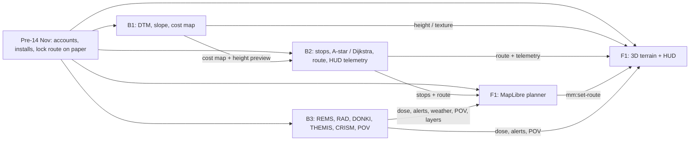

# ROADMAP — Martian Mappers, 48-hour build

Team **Martian Mappers**, NASA Space Apps 2026 (14–15 November). This is the hour-by-hour plan for six people. **No application code and no project data pipeline before 14 November 2026.** Until then, only accounts, installs, reading, route locking on paper / HiView, a practice pull request, and these docs.

Companion docs: [AGENTS.md](./AGENTS.md) (design and data sources), [docs/GITHUB_WORKFLOW.md](./docs/GITHUB_WORKFLOW.md) (how to use Git), [docs/roles/](./docs/roles/) (one sheet per person), [docs/contracts/](./docs/contracts/) (example JSON). The official [Resources tab](https://www.spaceappschallenge.org/2026/challenges/interplanetary-survival-guide-martian-map/) and judging guide arrive 13 November (**UNVERIFIED** until re-checked). Confirm the "do not build early" rule in the Project Submission Guide (expected 13 November).

## 1. Locked decisions (12 November 2026)

- **Site:** Gale crater / Mount Sharp (Curiosity). Stay inside the already-checked HiRISE DTM coverage, especially [DTEEC_019698](https://hirise-pds.lpl.arizona.edu/PDS/DTM/ESP/ORB_019600_019699/ESP_019698_1750_ESP_019988_1750/DTEEC_019698_1750_019988_1750_U01.IMG) (4.73–5.04°S, 137.31–137.44°E, includes the traverse). Curiosity was near 4.80°S, 137.39°E at Sol 4534 and about 4.83°S, 137.39°E at Sol 5070. Confirm chosen outcrops in [HiView](https://www.uahirise.org/hiview/) before committing.
- **Science goal:** ancient lake sediments and habitability / biosignature potential (organics in mudstones). The boxwork unit (Altadena member) is a **bonus stop**, not the only target. Exact outcrop names and coordinates are **not yet locked** — pick them against official NASA / Curiosity sources and the 13 November Resources tab, then write them into `data/processed/routing/stops.json` at hour 0. Until then, contract files use clearly labelled **example** coordinates only. Frame the story as "if a crew visited where Curiosity studied Mount Sharp." Gale is a rover site, not a human landing candidate.
- **Format:** a **web app**. A 2D [MapLibre](https://maplibre.org/maplibre-gl-js/docs/) planner map chooses and displays the route, then **sends that route** to a **3D first-person terrain view** with a **helmet HUD** overlay. Default 3D stack: [three.js](https://threejs.org/) heightmap (simpler for a new team). [CesiumJS](https://cesium.com/) is an option only if the frontend already knows it. **VR / WebXR headset mode is STRETCH only** (hours 32–40).
- **Team:** six vibe coders, new to GitHub and to map / 3D work, full 48 hours, aiming to win; registered with a guardian. Demo and submission: no photos, video, voices, or likenesses of under-18s.
- **Roles:** Backend 1 terrain · Backend 2 routing · Backend 3 data services · Frontend 1 planner + HUD · Bug testers 1 and 2.

## 2. Who owns which folders

Work only in your folders so merges stay easy. Do not edit someone else's tree without asking, and never both edit the same file.

| Role | Owns (write here) | Reads (do not write) |
|---|---|---|
| **Backend 1 — terrain** | `pipeline/terrain/`, `data/processed/terrain/`, `docs/contracts/cost-map.json` | routing and science JSON, `web/` |
| **Backend 2 — routing** | `pipeline/routing/`, `data/processed/routing/`, `docs/contracts/route.json`, `stops.json`, `hud-telemetry.json` | `data/processed/terrain/`, science JSON, `web/` |
| **Backend 3 — data** | `pipeline/data/`, `data/processed/science/`, `docs/contracts/dose.json`, `alerts.json`, `weather.json`, `layers-themis.json`, `layers-crism.json`, `pov-example.json` | route/stops, `web/` |
| **Frontend 1 — HUD** | `web/planner/`, `web/hud/`, `web/shared/`, `web/README.md` | all `docs/contracts/` and `data/processed/**` |
| **Tester 1** | `docs/testing/`, `docs/AI_USE.md` (log hygiene; everyone still adds their own rows) | everything, review-only outside `docs/testing/` |
| **Tester 2** | `docs/demo/` | everything, review-only outside `docs/demo/` |
| **Shared (ask first)** | `AGENTS.md`, `ROADMAP.md`, `docs/GITHUB_WORKFLOW.md`, `docs/contracts/README.md` | — |
| **Nobody commits** | `data/raw/`, `.env`, secrets, bulky `*.tif` / `.IMG` / JP2 | — |

`data/raw/` is gitignored. Everyone may *read* contract examples in `docs/contracts/` from hour 0; backends replace the examples with real (still small) JSON under `data/processed/` after 14 November. Frontend must load **processed files first**, then fall back to `docs/contracts/` so the UI runs even if a pipeline is late.

## 3. Interface contracts

Full example payloads: [docs/contracts/](./docs/contracts/). These are **sample data**, not computed products. Field names should stay stable; if you must change a field, update the contract file and tell Frontend 1 and both testers in the same PR.

Live HTTP is optional. Prefer writing JSON files the web app can fetch as static files. If Backend 2 or 3 later adds a tiny local API, use the same paths and the same shapes. The frontend **must** fall back to static JSON if the API is down.

| Endpoint (optional API) | Static file (required fallback) | Owner | Used by |
|---|---|---|---|
| `GET /api/cost-map` | `data/processed/terrain/cost-map.json` (fallback `docs/contracts/cost-map.json`) | B1 | B2, F1 |
| `GET /api/stops` | `data/processed/routing/stops.json` | B2 | F1, B3 (for POV Sols) |
| `GET /api/route` | `data/processed/routing/route.json` | B2 | F1 |
| `POST /api/route` | if compute fails, return or keep the last static `route.json` | B2 | F1 planner "recompute" |
| `GET /api/hud/telemetry?along_m=` | `data/processed/routing/hud-telemetry.json` (a sample, or a list of samples along the path) | B2 | F1 HUD |
| `GET /api/dose` | `data/processed/science/dose.json` | B3 | F1 |
| `GET /api/alerts` | `data/processed/science/alerts.json` | B3 | F1 |
| `GET /api/weather` | `data/processed/science/weather.json` | B3 | F1 |
| `GET /api/layers/themis` | `data/processed/science/layers-themis.json` | B3 | F1 planner |
| `GET /api/layers/crism` | `data/processed/science/layers-crism.json` | B3 | F1 planner |
| `GET /api/stops/:id/pov` | `data/processed/science/pov-example.json` (later `pov/<id>.json`) | B3 | F1 |

### Planner → HUD (in the browser, not HTTP)

When the planner has a route (from `route.json` or a recompute), Frontend 1 sends it to the 3D view through a small shared helper, for example `web/shared/route-bridge.js` (created on 14 November). Suggested event name: `mm:set-route`. Payload: the `route` contract object plus current `along_m` (0 at the start of the demo). The HUD must work if this event is fired once with the static route file, even when "recompute" does not exist.

### Shape summary (see the JSON files for full examples)

- **cost-map:** `contract`, `status`, `crs`, `mars_radius_km`, `cell_size_m`, `bounds` (west, south, east, north in lon/lat), `slope_limit_deg`, colour classes, URLs to a small preview PNG and optional grid size, `notes` (DTM under-reads tilt; limits are lunar stand-ins).
- **stops:** a FeatureCollection of habitat + lake-sediment stops + boxwork bonus; each stop has `id`, `name`, `kind`, `lat`/`lon` or GeoJSON coordinates, `science_summary`, `sol_hint` (optional, for POV), `is_example`.
- **route:** a LineString in lon, lat; `legs` between stop ids; `profile[]` of `{s_m, elev_m, slope_deg}`; `totals` (distance_m, climb_m, descent_m, duration_min_placeholder); notes for placeholder time and slope limit.
- **hud-telemetry:** `along_route_m`, position, `heading_deg`, `distance_to_next_stop_m`, `distance_remaining_m`, `distance_travelled_m`, `slope_deg`, `slope_class`, `next_stop_id`, `suit_o2_remaining_percent` plus a note that O₂ is an **illustrative** linear placeholder, not a validated Mars suit model.
- **dose:** RAD baseline 0.64 ± 0.12 mSv/day ([Hassler et al., Science 2014](https://www.science.org/doi/10.1126/science.1244797)) × placeholder EVA duration; no spatial "radiation map" of rocks.
- **alerts:** cached DONKI WSA-Enlil items with `mars_in_impact_list`, plus a banner string. The 2025-05-08 12:00Z Mars arrival in the example comes from the 11 November 2026 planning check.
- **weather / layers / pov:** small metadata + file URLs or cached image paths, never raw archives in git.

Coordinates in every example file are **placeholders** near the published traverse, not chosen science outcrops.

### Demo-safe mode (spec only until 14 November)

By **hour 32** the web app must support a **demo-safe** switch so the stage demo works with no venue network and no live NASA or DONKI calls.

- **On:** environment variable `DEMO_SAFE=1`, or the URL query `?demo=1`. Either one is enough. (Placeholder name also listed in `.env.example`. Do not implement the flag before 14 November.)
- **Behaviour:** load **only** bundled fixtures from [`data/demo/`](./data/demo/README.md) (and other files already shipped with the static app). No fetches to PDS, Mars Trek, api.nasa.gov, DONKI, raw-image feeds, or any other network host. If a fixture is missing, show an honest empty state — still no network.
- **Owner:** Frontend 1 implements the flag and loader. Backends 1–3 drop a small frozen copy of their contract-shaped JSON (and a few previews or POV stills) into `data/demo/`. Tester 1 verifies, as a checklist item, that demo-safe mode makes no network calls. Board task **SHOULD-07**.
- Until fixtures exist, `docs/contracts/` is the shape reference, not a live demo-safe bundle.

## 4. Dependencies

**Critical path for the MUST demo (hour 16):** B1 cost map and a small height preview → B2 static route and telemetry → F1 3D view plus HUD (distance, slope, next stop, suit O₂) and a planner that sends the route. If B1 or B2 is late, F1 stays on `docs/contracts/` samples so a 3D walk is still showable.

## 5. Pre-14 November (allowed prep only)

No project code, no `package.json` install in this repo, no notebooks, no pipeline runs, no bulk science downloads into a project pipeline. Reading, tool installs, GitHub practice, and choosing stops on paper / HiView are fine.

| Who | Tasks |
|---|---|
| All | Create a GitHub account; get added to this private repo; install Git, Python 3, and a code editor; read [docs/GITHUB_WORKFLOW.md](./docs/GITHUB_WORKFLOW.md); complete **one practice PR** (add your GitHub username to [docs/team/ROSTER.md](./docs/team/ROSTER.md)); first agent session: onboarding interview into [docs/team/profiles/](./docs/team/profiles/); read AGENTS.md, this roadmap, and your role sheet; log work in [AGENT_LOG.md](./docs/coordination/AGENT_LOG.md). |
| All, on 13 Nov | Read the official Resources tab, Project Submission Guide, and judging guide (**UNVERIFIED** until they appear). Testers update [docs/JUDGING_CHECKLIST.md](./docs/JUDGING_CHECKLIST.md) (board PRE-06). Adjust this plan if the guide requires it; do not start coding. |
| B1 | Install GDAL with OpenJPEG; run `gdalinfo --formats` on your machine (not on project data); skim [gdaldem](https://gdal.org/en/stable/programs/gdaldem.html) and the PDS driver notes in AGENTS.md. |
| B2 | Understand A\* / Dijkstra at a high level; read the route contract; sit with the team to **lock stop candidates** on HiView / official maps (write ids and reasons in a notes issue or on paper — not application code). |
| B3 | Request a free personal key at [api.nasa.gov](https://api.nasa.gov/) and store it only in a local `.env` (never commit it, never paste it into chat). Do not begin the project DONKI/REMS pipeline yet. |
| F1 | Install a current browser and, if you want, a local static server you already use; watch a short three.js + MapLibre intro; sketch the HUD layout on paper (distance, slope, next stop, O₂). |
| T1, T2 | Draft empty checklists in your folders (docs only); schedule a demo-rehearsal slot at hours 40–44; confirm the under-18 recording rule with the team. |

**Route lock (prep, not code):** pick a habitat / start point, two lake-sediment / mudstone stops, and a boxwork bonus stop, all inside DTEEC_019698 (and the ortho footprint). If a favourite outcrop sits outside the DTM, drop it or move it. Testers record the locked ids in `docs/testing/` once agreed. Coordinates go into `stops.json` only after 14 November.

## 6. Hour-by-hour plan (hackathon clock)

The clock starts at official kickoff for your event (local or virtual). If kickoff is delayed, keep this sequence and compress later stretch, never the MUST block.

### Hours 0–16 — MUST (terrain, safe route, 3D, basic HUD)

Nothing in this block depends on DONKI, POV, or thermal layers.

| Hours | Backend 1 | Backend 2 | Backend 3 | Frontend 1 | Testers |
|---|---|---|---|---|---|
| **0–2** | Pull `main`. Confirm DTM / ortho URLs. Start the HiRISE DTM + ortho download into `data/raw/` (gitignored). `gdalinfo` on the DTM. | Pull `main`. Write real locked stops into `data/processed/routing/stops.json` using the contract shape (no longer `is_example` for locked stops). | Pull `main`. Start background downloads you will need later (REMS, RAD, waypoints, DONKI cache, image list). Do not block the MUST path. | Scaffold `web/planner/` (MapLibre, Trek or a solid colour base if tiles are delayed) and `web/hud/` (three.js empty scene + HUD chrome). Load **contract** JSON so dummy HUD numbers already appear. | Confirm all six can clone and run a static preview. Open a kickoff checklist. Review the first PRs. |
| **2–6** | Crop to ~2 km × 2 km around the locked walk. Average-resample to 2–5 m. First `gdaldem slope` and a small preview PNG. | If the cost map is not ready, keep using the example grid / a coarse slope later — but prefer waiting for B1's preview. Sketch leg order: habitat → mudstone A → mudstone B → boxwork bonus → back (adjust to the locked ids). | Continue caching; parse waypoint `tilt` so B1 can validate later. Prepare empty `dose.json` / `alerts.json` shells if useful, without inventing rates. | Bring in B1's height preview as soon as a small file exists; otherwise a flat plane plus HUD is fine for an hour. Camera: first-person, mouse look or simple walk-along-path. | Visual check of the crop and stops against HiView / official context. File issues, do not silently edit others' files. |
| **6–10** | Roughness / TRI, no-data mask, slope classes, `cost-map.json` + preview written to `data/processed/terrain/`. Hand off to B2 and F1. | A\* / Dijkstra on the cost grid (or `skimage.graph.route_through_array`). Produce `route.json` with profile and totals. If the solver fails, **manually digitize a clearly safe path** as static GeoJSON and label it. | Optional: first cached DONKI fetch (personal `NASA_API_KEY` only). Not required for MUST. | Planner shows stops, route line, and hazard preview. Implement `mm:set-route` into the HUD. HUD reads telemetry along the path (or interpolates the route profile). | Test: planner click or "start EVA" sends the route; HUD updates distance and next stop. |
| **10–14** | Tilt check vs Curiosity waypoints; note the known under-read in `cost-map.json`. Improve no-data / obstacle handling if easy. Freeze the MUST raster. | `hud-telemetry.json` samples along the route. Suit O₂ field: linear placeholder from elapsed / planned time (document the formula). | Help F1 with any static file paths; keep caching. | **Basic HUD complete:** distance (travelled + remaining or to next stop), slope (number + colour class), next stop name, suit O₂ %. 3D terrain textured with a cropped ortho or a slope colour if the ortho tile step is late. | Walk the MUST test plan. File blockers only. |
| **14–16** | Bugfix only. | Bugfix only. Keep a static `route.json` that demos without running a solver. | Do not merge SHOULD features into the MUST demo yet. | Polish first-person walk; fallback path if a processed file is missing: load `docs/contracts/`. | **MUST sign-off** (see §7). If something fails, switch that piece to contract JSON and record it. |

### Hours 16–32 — SHOULD (dose, DONKI, POV, weather / thermal)

MUST is frozen except for bug fixes. New work goes on branches and can be hidden behind a simple toggle if it risks the demo.

| Hours | Backend 1 | Backend 2 | Backend 3 | Frontend 1 | Testers |
|---|---|---|---|---|---|
| **16–22** | Optional: 15° / 20° mask as a second layer for the planner toggle. Stay available for terrain bugs. | Optional: toggle the route at 15° vs 20°. Compare a trace against Curiosity's traverse JSON if time. | **Dose budget** from RAD baseline × duration (and real RAD tables for relevant Sols if parsed). **DONKI** banner from cached WSA-Enlil Mars arrivals. Write `dose.json` and `alerts.json`. | Dose card + space-weather banner on the HUD and/or planner. Fail safe: hide the banner if the file is missing. | SHOULD test plan starts. Check numbers against the cited baseline and the cached alert note. |
| **22–28** | Help with ortho tiles if F1 still needs a texture. | Hook "recompute" only if the MUST route stays the default when the API fails. | **POV photos** for each stop (cached JPEGs + `pov/*.json`). **Weather** (REMS temperature by time of day — pick a cooler EVA window). | Click-a-stop shows a rover POV still. Weather / time-of-day note on the planner. | Check each stop has a photo, or an honest "no image" state. |
| **28–32** | Spare / bugfix. Help freeze a tiny `data/demo/` copy of the cost preview. | Spare / bugfix. Help freeze route/stops/telemetry fixtures into `data/demo/`. | **THEMIS** (and CRISM if ready) layer metadata for the planner. If CRISM is too hard, skip and say so; THEMIS tiles from Trek plus a legend still count as a thermal layer. Freeze science fixtures into `data/demo/`. | Toggle THEMIS (and CRISM if present) on the 2D planner. Legend and source list visible. **Ship demo-safe mode** (`DEMO_SAFE=1` / `?demo=1`). | **SHOULD sign-off**, including the **demo-safe network-off check**. Anything incomplete is dropped or labelled "not in demo." |

### Hours 32–40 — STRETCH only (VR, paired rover)

No new stretch after hour 40. If MUST or SHOULD is still shaky, **do not start stretch.**

| Hours | Who | Work |
|---|---|---|
| **32–40** | F1, with T2 watching | WebXR headset mode: same HUD, first-person terrain, optional look-around. Must degrade to the normal web view if WebXR is unavailable. |
| **32–40** | B2 + F1 | Paired rover mode: show Curiosity's known traverse as a precursor / "rover-assisted" path beside the crew route. |
| **32–40** | B1 / B3 optional | Automatic boulder detection, sky-view factor, predicted-conditions slider — only if the owners are idle and testers agree it will not break the demo. |
| **All** | — | Any stretch that is not stable at hour 40 is turned off (feature flag or unused branch). |

### Hours 40–48 — freeze, story, submit early

**Nothing new after hour 40** (no new features, layers, or libraries).

| Hours | Who | Work |
|---|---|---|
| **40–44** | All | Feature freeze. Testers run the full rehearsal. F1 + T2: 30-second screen-recording video with captions (no under-18 faces or voices). T2 + a presenter: slides. T1: SI-tools paragraph from `docs/AI_USE.md`, source list, known limits (lunar slope stand-in, DTM under-reads tilt, radiation is a time problem, O₂ is illustrative). |
| **44–48** | All | **Submit early.** Keep a backup of the recording and a tagged commit (for example `demo-submit`). Stay available for upload issues. Do not "just add one more thing." |

## 7. Definition of done

### MUST (hour 16)

- A cropped Mount Sharp terrain with a slope / hazard cost map (or an honest static preview if the full raster failed, documented in the PR).
- A walkable **safe route** between the locked stops that avoids blocked cells, with distance and climb. A hand-drawn but clearly safe static GeoJSON is acceptable if the solver fails, and must be labelled.
- 3D first-person view of that terrain (even if the texture is a slope colour, not the full ortho).
- Helmet HUD showing **distance**, **slope**, **next stop**, and **suit O₂** (O₂ labelled as a placeholder).
- 2D MapLibre planner shows the same route and **sends it** to the HUD.
- Offline or cached enough to demo if the room Wi-Fi dies (at least local JSON + local height preview).
- Sources and honesty notes reachable from the UI or a visible credits panel.
- Testers have signed the MUST checklist.

### SHOULD (hour 32)

- Dose budget on the HUD using the RAD baseline (and Sol tables if available).
- DONKI / WSA-Enlil banner from **cached** JSON.
- Rover POV still at each stop, or an honest empty state.
- At least one weather or thermal product on the planner (REMS and/or THEMIS). CRISM if it made it.
- **Demo-safe mode** works: `DEMO_SAFE=1` or `?demo=1` loads only `data/demo/` fixtures and makes no network, NASA, or DONKI calls (tester-verified).
- 15° / 20° toggle is nice but not required to pass SHOULD.

### STRETCH (hour 40)

- WebXR mode works on at least one team headset or a browser WebXR emulator, and does not break the non-VR demo.
- Paired rover mode can be shown in one click and hidden in one click.

### SUBMIT (hour 44)

- Frozen demo, 30-second video, slides, project description, SI-tools disclosure, source list, backup recording, early upload attempted.
- No under-18 likenesses or voices.

## 8. Risks and fallbacks

| Risk | Fallback |
|---|---|
| Official guide on 13 Nov changes a rule | Testers update the checklist the same day; coding still starts only on 14 Nov. |
| Chosen outcrop is outside the DTM | Move the stop or drop it; never invent terrain. Backup site remains Jezero only if the whole Gale footprint fails (unlikely given DTEEC_019698). |
| GDAL / JP2 / huge DTM fails | Windowed reads; 5 m resample; a smaller crop; last resort: a tiny height PNG already in `data/processed/terrain/` and the contract cost-map. |
| Router crashes or is slow | Ship a **precomputed static** `route.json` (solver output or carefully drawn on the hazard map). Keep the API optional. |
| API process dies mid-demo | Frontend already uses static files. No live API required on stage. |
| Trek tiles need internet | Cache the demo bbox offline; if cache is incomplete, use the ortho / slope preview as the only base map. By hour 32, use **demo-safe mode** (`?demo=1` / `DEMO_SAFE=1`) so the stage machine never needs the network. |
| DONKI key or rate limit | Cached `alerts.json` from a prep-day or hour-0 fetch. Never use the shared demo key. |
| Raw-image feed changes or 404 | Pre-cached JPEGs in `data/processed/science/` (small, a few images only). |
| three.js / 3D too slow or too hard | Lower-resolution heightmap; shorter far-clip; or a first-person walk along a textured "ribbon" of the route. Last resort: HUD overlay on a scripted camera path / stills, still driven by `route.json`. CesiumJS only if already known — do not learn it during hours 0–16. |
| WebXR breaks the page | Stretch stays behind a flag; default is the web HUD. |
| Merge conflicts | Folder ownership; small PRs; testers review; see [docs/GITHUB_WORKFLOW.md](./docs/GITHUB_WORKFLOW.md). Never force-push `main`. |
| Secret almost committed | Testers reject the PR. Rotate the NASA key if it leaked. |
| Time slip on MUST | Cut SHOULD/STRETCH. F1 stays on contract JSON. B3 does not block the 3D walk. |
| Suit O₂ or walk time looks "scientific" | Label both as **illustrative placeholders** (Earth hiking / linear O₂). |
| Under-18 in a recording | Delete that take (local only), reshoot as screen + captions. |

## 9. How to start reading

1. Your [role sheet](./docs/roles/).
2. This file, §2–§7.
3. [docs/contracts/README.md](./docs/contracts/README.md) and the JSON for your outputs.
4. [docs/GITHUB_WORKFLOW.md](./docs/GITHUB_WORKFLOW.md).
5. [AGENTS.md](./AGENTS.md) for data links, slope and radiation rules, sources, and the session / log rules.
6. [docs/coordination/BOARD.md](./docs/coordination/BOARD.md) and the latest [AGENT_LOG.md](./docs/coordination/AGENT_LOG.md) entries.
